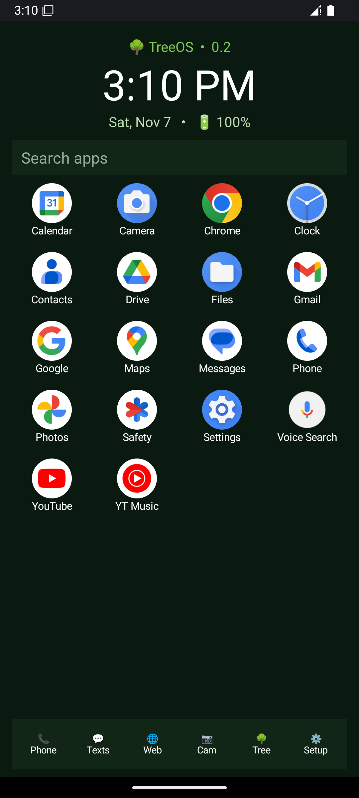

# XodOS

Renamed from TreeOS on 2026-11-07 — same project, new name.

An open Android OS, built by [Rene Turcios](https://github.com/CloudCorpRecords).

XodOS is two things that ship as one:

- **A system image** — a GSI-style Android system image with XodOS baked in as
  system apps, defined once by a written spec
  ([`docs/CONTENT-MANIFEST.md`](docs/CONTENT-MANIFEST.md)) so the same OS builds
  for the emulator today and for phones later.
- **Its own app suite** — a home/launcher plus XodOS apps (Calculator, Notes,
  Flashlight, About), plain Java, no proprietary dependencies.



*XodOS home (as TreeOS), first boot of the standalone image after a factory wipe — no
install step, no setup commands. The image boots straight to XodOS.*

## Status — stated plainly

| Piece | State |
|---|---|
| Emulator system image (x86_64) | **Proven.** Boots plain, factory-wiped, straight to TreeOS home. Evidence: [`docs/history/IMAGE-REPORT.md`](docs/history/IMAGE-REPORT.md), [`docs/history/QA-REPORT-V03.md`](docs/history/QA-REPORT-V03.md) |
| Launcher suite | v0.4.0 in `launcher/` — home, app search, dock, Tree panel, Calculator, Notes, Flashlight, About |
| Phone image (arm64 GSI) | Spec is ready (the manifest is architecture-neutral); the image is **not built yet** |
| Flashing a real phone | **Deferred on purpose.** No phone has been flashed. When it happens: unlockable Pixel first, DSU temporary boot before any permanent flash |
| Open base (AOSP, no Google apps) | Direction, not yet built — see [`docs/OPENNESS.md`](docs/OPENNESS.md) |

## Build the launcher

Needs a JDK and the Android SDK (platform 35, build-tools 36), Gradle 9.1,
AGP 9.0.1.

```sh
cd launcher
gradle :app:assembleDebug
# → app/build/outputs/apk/debug/app-debug.apk
```

The scripts of record for our reference build machine are in
[`scripts/`](scripts/) (`build-on-razer*.ps1`).

## Build the system image

The image is not compiled from AOSP (yet). It is *reproduced*: the manifest
lists every file XodOS adds to a stock base image — destination, source,
SHA-256, mode, owner, SELinux label — plus a 7-step checklist that ends in
boot read-backs.

1. Start from a stock `system-images;android-35;google_apis;x86_64` image.
2. Follow [`docs/CONTENT-MANIFEST.md`](docs/CONTENT-MANIFEST.md) using the
   tooling in [`image-surgery/`](image-surgery/) (liblp metadata parser,
   resource tooling, overlay builder) and `debugfs` to place the files.
3. Boot it and pass the checklist gates: `pm path` resolves to the priv-app,
   the HOME role holder is `dev.treeos.launcher` on a wiped boot with no
   setup commands, zero parse failures in logcat.

## What's in here

- `launcher/` — the TreeOS suite (Android Gradle project)
- `image-surgery/` — the tools that write TreeOS into a system image
- `overlay/settings-provider/` — the static overlay that makes a wiped boot
  land on TreeOS home (manifest item 6)
- `bootanim/` — boot animation sources
- `docs/` — plan, image plan, the content manifest (the OS spec), openness
  direction, and the full build/QA report history under `docs/history/`
- `scripts/` — build, proof, and ship scripts referenced by the reports
- `emulator/` — the emulator test recipe

## License

Apache License 2.0 — see [`LICENSE`](LICENSE). It covers the TreeOS-owned
content in this repo: exactly the files
[`docs/CONTENT-MANIFEST.md`](docs/CONTENT-MANIFEST.md) lists as XodOS's.

One boundary, stated plainly: the current **test** image is built on Google's
`android-35 google_apis` base, which contains Google-proprietary apps. Those
apps are **not** part of XodOS, are **not** covered by this license, and are
**not** distributed here — this repo contains no system images and no APK
binaries, only the source and tooling to reproduce XodOS's additions. The
open distribution base (AOSP, no Google apps) is the direction in
[`docs/OPENNESS.md`](docs/OPENNESS.md).
